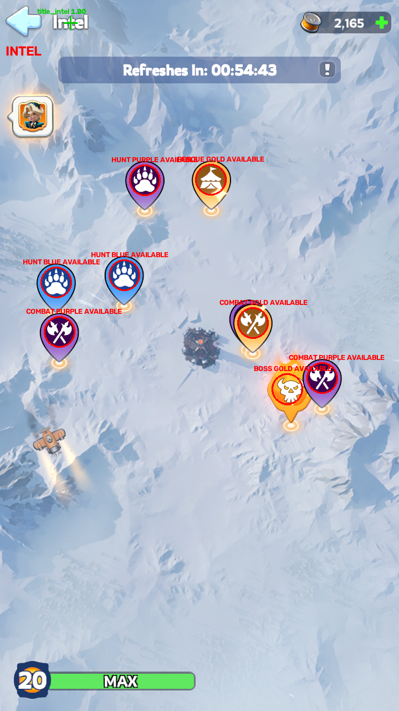
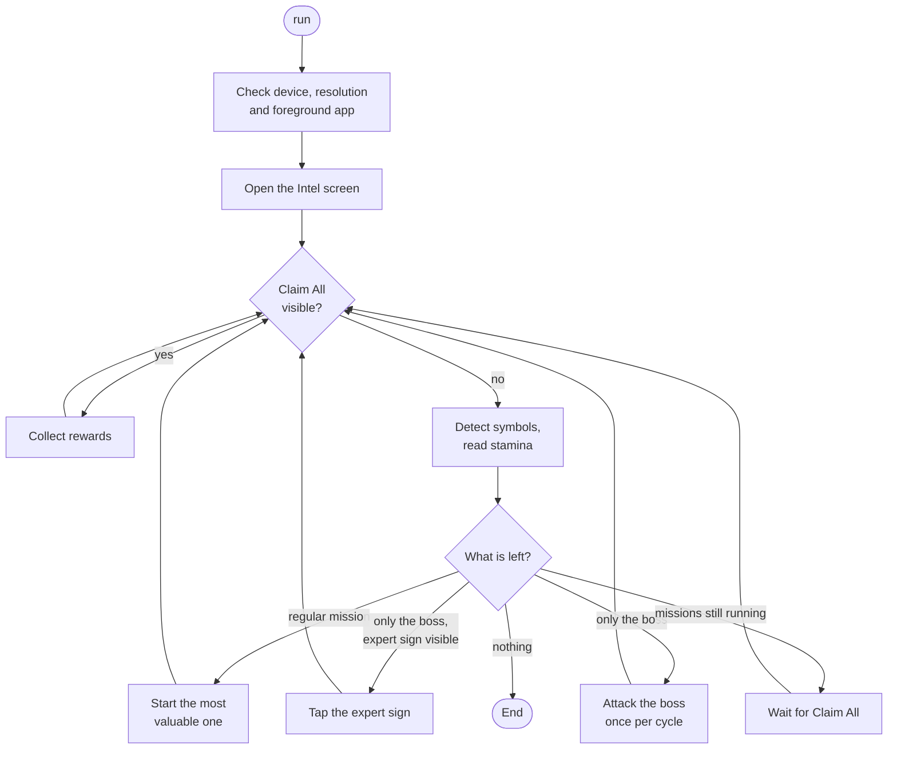

# wos-intel

**Sample code: how hands-free Intel missions for *Whiteout Survival* can be implemented.**
`wos-intel` looks at the game through ADB screenshots, recognises every mission pin on the Intel
screen, starts the missions in order of value, waits for them to finish and collects the
rewards – designed never to move the map or touch anything it has not positively identified.

It is published as a worked example of screen detection and a careful automation loop, not as a
product. It works on the author's setup; on any other setup it has to be treated as untested.


<p align="center">
  
</p>
<p align="center"><em>
  Output of <code>detect</code> on a reference screenshot: eight missions and the boss, each with
  type, tier and status.
</em></p>

> [!WARNING]
> **This is sample code and it is potentially dangerous.** It sends real input to a real game
> account. It works for the author; used as is on another account, device or game version it
> **may cause damage**. Back up and protect everything of value to you **before** you run it.
> It is provided **as is, without any warranty and without any guaranteed feature**, and you use
> it **at your own risk**: the author is not responsible, financially or otherwise, for anything
> it loses, spends or breaks, inside the game or outside it.
> Read the [disclaimer](#disclaimer) first.

## What it does

- **Finds every mission** on the Intel screen: hunt, rescue, combat and the boss, with its tier
  (gold, purple, blue) and status (available, running, done).
- **Works by value**: highest tier first, top to bottom within a tier, the boss last and only
  once per refresh cycle.
- **Runs each mission's own sequence** and checks every screen on the way before it taps.
- **Reads the stamina** from the screen and skips what it cannot afford.
- **Takes the daily expert offer** when no regular mission is left, so it never expires.
- **Waits for running missions** and collects the rewards with "Claim All" before it ends.
- **Stops cleanly** when nothing is left to do, the stamina runs out, or something looks wrong.

## How a run works



| Mission | Symbol | Sequence | Stamina |
|---|---|---|---|
| Hunt | paw | View → Attack → Deploy | 10 |
| Rescue | tent | View → Rescue | 12 |
| Combat | crossed halberds | View → Explore → Fight → Victory | 10 |
| Boss | skull in flames | like hunt, last and once per refresh cycle | 10 |

## Quick start

Read the [disclaimer](#disclaimer) and protect your account before you start.

You need macOS with [BlueStacks Air](https://www.bluestacks.com/mac), the game installed in it
with its language set to **English**, [uv](https://docs.astral.sh/uv/) and `adb`.

```sh
brew install android-platform-tools      # provides adb
git clone git@github.com:wos-automator/wos-intel-cli.git
cd wos-intel-cli
uv sync
```

Set BlueStacks to 720×1280 portrait and switch on the Android Debug Bridge
(→ [BlueStacks and ADB setup](docs/guides/bluestacks-setup.md)), open the game on the world map,
then:

```sh
adb connect 127.0.0.1:5555
uv run python -m wos_intel run --dry-run   # look, log, never tap
uv run python -m wos_intel run             # the real thing
```

The log shows what the tool sees. This is `detect` on the reference screenshot above:

```text
INFO    state INTEL
INFO    stamina 2165
INFO    refresh in 3283 s
INFO    symbol RESCUE GOLD AVAILABLE at 380,323 (score 0.95, sat 213)
INFO    symbol COMBAT GOLD AVAILABLE at 456,581 (score 0.92, sat 208)
INFO    symbol BOSS GOLD AVAILABLE at 518,700 (score 0.90, sat 213)
INFO    symbol HUNT PURPLE AVAILABLE at 261,324 (score 0.94, sat 252)
...
```

## Commands

| Command | Purpose |
|---|---|
| `run` | Claim rewards and start all available missions |
| `run --dry-run` | Detect and log, never tap |
| `run --debug` | Additionally save an annotated screenshot per step under `debug/` |
| `detect <image>` | Run the detection on a 720×1280 image file and write `<image>.debug.png` |
| `snap <name>` | Save an ADB screenshot as `ref/<name>.png` |

All commands are run as `uv run python -m wos_intel <command>`. Details, run outcomes and
troubleshooting are in the [usage guide](docs/guides/usage.md).

## Built to be careful

These rules describe how the sample is designed. They reduce the risk of a wrong tap; they are
not a guarantee (see the [disclaimer](#disclaimer)).

- **ADB only.** No mouse or keyboard input through macOS, no swipe, no zoom: the map never moves.
- **Fresh screenshot before every decision.** Taps are never chained blindly.
- **Taps only on detected targets.** Buttons are found by template, not by fixed coordinates.
- **Plausibility checks.** The dialog must show the expected mission type and the popup the
  expected action, otherwise the mission is skipped for this run.
- **No losing fights.** A hunt is only deployed when the game says "You are quite likely to
  prevail". The boss is the deliberate exception.
- **Never confirms shop, purchase or offer dialogs.** An unknown dialog is answered with BACK.
- **Bounded.** At most 30 missions per run, three consecutive failures end the run, and the
  screenshot of every skipped mission or failed step is kept under `debug/`.

## Configuration

Every threshold, wait time, region and cost lives in [`config.toml`](config.toml); the file
lists the built-in defaults. The device is taken from `ANDROID_SERIAL` if set, otherwise from
`device.serial` (default `127.0.0.1:5555`).

## Documentation

| Document | Content |
|---|---|
| [BlueStacks and ADB setup](docs/guides/bluestacks-setup.md) | Display settings, debugging port, connection check |
| [Usage guide](docs/guides/usage.md) | Running, outcomes, configuration, troubleshooting |
| [`SPEC.md`](SPEC.md) | Screens, detection method and the run loop in detail (index of `specification/stakeholder/`) |
| [Requirements](specification-web.adoc), [technical specification](tech-specification-web.adoc), [backlog](backlog-web.adoc) | Traceable specification in AsciiDoc |
| [Release notes](release-notes.adoc) | Features and known limitations per version |

## Project layout

```text
wos_intel/     CLI, ADB wrapper, detection, run loop, boss state
templates/     symbol masks, button and title cut-outs, digit glyphs
ref/           reference screenshots the tests run against
tests/         unit, component, integration and blackbox tests
tools/         template cutter and the detection prototype
docs/          guides and images
specification/ requirements, technical specification, backlog, release notes, stakeholder input
```

## Development

```sh
uv run poe check    # ruff, format check, mypy, pytest and the specification validator
```

The detection is tested against the screenshots in `ref/`; the run loop against a scripted fake
game. Conventions are in [`AGENTS.md`](AGENTS.md).

## Status and limitations

Version 0.1.0. The known limitations are listed in the
[release notes](specification/release-notes/0.1.0.adoc); the most relevant ones:

- Rescue, defeat and the dialogs for missing stamina or troops have no reference screenshot yet
  and are tested on synthetic screens only.
- The stamina digit 8 can be misread.
- Only 720×1280 portrait with the game in English is supported.

## License

`wos-intel` is free software, licensed under the
[GNU General Public License, version 3](LICENSE).

## Disclaimer

**This is sample code. It is potentially dangerous. Use it as is, entirely at your own risk.**

- **Sample code, not a product.** This repository shows how such an automation could be
  implemented. It was written for, and has only ever been run on, the author's own setup: one
  account, one emulator configuration, one game version and language. That it works there says
  nothing about any other setup.
- **Used as is, it may cause damage.** On another account, device, resolution, language or game
  version the detection can be wrong and the taps can land on something else. You are expected
  to read and understand the code and to adapt and test it for your own setup before you rely
  on it.
- **Protect your values first.** Before you use this software, you must take your own backup and
  protection measures for everything that is of value to you, inside the game and outside it.
  For example: secure and bind the game account, do not keep it in a state where a wrong tap can
  spend what you cannot afford to lose, protect in-app purchases with a password or disable
  them, back up the data on the machine you run it on, and try it on an account you can afford
  to lose first. Choosing these measures, and whether they are sufficient, is your
  responsibility alone.
- **No warranty.** The software is provided "as is", without warranty of any kind, express or
  implied, including but not limited to merchantability and fitness for a particular purpose.
  Nobody promises that it works, that it keeps working after a game update, or that it does what
  you expect.
- **No guaranteed features.** Nothing in this README, the guides, the specifications or the
  release notes is a promise. Every feature, behaviour, safety rule, limit and measured value
  described there states what the software is intended to do, not what it is guaranteed to do.
  No feature is guaranteed to exist, to work, to be complete or correct, or to remain available,
  and there is no entitlement to support, fixes, updates or compatibility with future versions
  of the game or of BlueStacks.
- **No liability.** The author is not liable for any damage or loss that results from using it,
  whatever the cause. That includes, without limitation, lost or wasted stamina, troops, heroes,
  resources, rewards, purchases or progress, missions and fights started or lost, and
  restrictions, suspensions or bans of your game account.
- **No financial obligations, and no liability beyond the game.** The author accepts no financial
  obligation of any kind towards anyone: no compensation, refund, reimbursement, replacement or
  damages. This covers real-world values as much as in-game ones, including, without limitation,
  money spent on the game or on in-app purchases, the monetary value of an account, lost
  income, profit or time, loss of or damage to data, software, hardware or other property, and
  any direct, indirect, incidental, special or consequential damage, to you or to third parties.
- **It sends real input to your real account.** Every tap spends real in-game resources and
  cannot be taken back. The safety rules above reduce the risk of a wrong tap; they do not
  remove it. If the tool destroys something of value, that is your loss, not the author's.
- **It may be against the rules.** Automating a game can violate its terms of service. Whether
  you may use this tool is for you to find out, and the consequences are yours.
- **Not affiliated.** This is an unofficial hobby project. It is not affiliated with, endorsed
  by or supported by the makers or publishers of *Whiteout Survival* or of BlueStacks. All
  trademarks and game assets belong to their owners.

If you do not accept this, do not use the software. Start with `run --dry-run`, read the log,
and only then let it tap. Sections 15 to 17 of the [license](LICENSE) apply in full.
